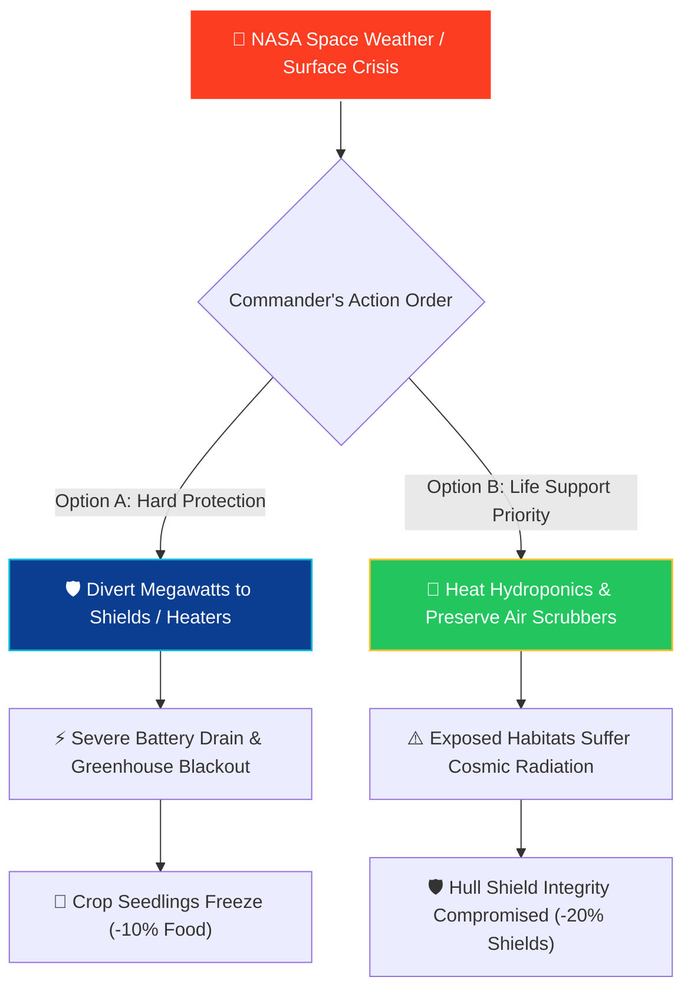

<div align="center">

# 🚀 Outpost Sol-1: Mission Commander
### *NASA Space Apps Challenge — Next-Gen Interactive Space Simulation*

[](https://www.spaceappschallenge.org/)
[](https://nasa.gov)
[](LICENSE)
[](https://react.dev)
[](https://brm.io/matter-js/)

**"Step into the boots of a NASA Outpost Commander on Mars. Every sol brings real space weather, real science, and decisions where no choice is free."**

[Explore Live Demo](#-live-demo--deployment) • [NASA Data Grounding](#-real-nasa-data-grounding) • [Engineering Trade-Offs](#-trade-off-mechanics--eclss-loop) • [Pedagogy & Design](#-target-audience-breakdown-ages-712) • [Local Setup](#-quick-start--local-installation)

</div>

---

## 🌟 Executive Summary

**Outpost Sol-1: Mission Commander** is a gamified web simulation that transforms complex NASA telemetry, heliophysics data, and closed-loop life support engineering into an intuitive, high-stakes strategy experience for **kids aged 7–12**.

Rather than relying on fictional sci-fi tropes, Outpost Sol-1 grounds every crisis in authentic datasets from **NASA DONKI**, **NASA Mars InSight & Curiosity**, and **NASA OSDR** (Open Science Data Repository). Players must balance 4 core life support tracks—**Power (⚡)**, **Oxygen (💨)**, **Radiation Shielding (🛡️)**, and **Biomass/Food (🌱)**—across a 10-sol planetary expedition where every single decision demands a strategic trade-off.

---

## 🎯 Target Audience Breakdown (Ages 7–12)

Children in the 7–12 age bracket transition from concrete operational thinking to basic hypothetical reasoning. Outpost Sol-1 is specifically architected to scaffold this cognitive leap:

```
┌────────────────────────────────────────────────────────────────────────┐
│                        COGNITIVE SCAFFOLDING                           │
├────────────────────────────┬───────────────────────────────────────────┤
│ 1. Visual & Kinetic        │ • Matter.js physics sandbox: drag, toss,  │
│    Sensory Feedback        │   and stack habitat modules in real-time. │
│                            │ • One-touch Lunar Gravity (0.16G) vs.     │
│                            │   Zero-G Antigravity thruster toggle.     │
│                            │ • Red ambient warning klaxon & scan lines │
│                            │   when telemetry falls below 30%.         │
├────────────────────────────┼───────────────────────────────────────────┤
│ 2. Intuitive Telemetry     │ • 4 primary resource tracks paired with   │
│    Dashboard               │   distinct color gradients and emoji.     │
│                            │ • Clear "+/-" impact tags on choices.     │
│                            │ • Zero confusing multi-level menus.       │
├────────────────────────────┼───────────────────────────────────────────┤
│ 3. Growth Mindset          │ • Failure is never a dead end: hitting 0% │
│    Educational Debriefs    │   triggers an Apollo 13 / InSight root-   │
│                            │   cause debrief explaining the physics.   │
├────────────────────────────┼───────────────────────────────────────────┤
│ 4. "NASA Science Behind    │ • Collapsible badge on every Sol incident │
│    This Decision"          │   explaining real spacecraft engineering  │
│                            │   in bite-sized 4th–6th grade prose.      │
├────────────────────────────┼───────────────────────────────────────────┤
│ 5. Sensory Inclusivity     │ • Pure Web Audio API synthesized audio:   │
│    & Zero-Asset Sound      │   subtle clicks, alarm beeps & fanfares.  │
│                            │ • One-click mute toggle for classrooms.   │
└────────────────────────────┴───────────────────────────────────────────┘
```

---

## 🛰️ Real NASA Data Grounding

Every Sol scenario in Outpost Sol-1 is directly derived from published NASA open data repositories:

| NASA Open Dataset | Real Mission Source | In-Game Simulation Mechanic | Authentic NASA Engineering Principle |
| :--- | :--- | :--- | :--- |
| **NASA DONKI**<br>*(Space Weather Database)* | SOHO, STEREO, ACE, SDO satellites | **Solar Flares (FLR), Coronal Mass Ejections (CME), Geomagnetic Storms (GST), Solar Energetic Particles (SEP)** | High-energy protons penetrate spacecraft hulls. Crew must shelter in water-lined modules or divert battery power to electromagnetic shields. |
| **NASA Mars InSight**<br>*(SEIS & TWINS)* | Mars InSight Lander (Elysium Planitia) | **Solar Panel Dust Accumulation & Dust Devil Cleaning Events** | Martian dust adheres statically to solar arrays, cutting power by up to 30%. InSight engineers used wind-blown sand bouncing ("saltation") to clean panels. |
| **NASA Curiosity / MRO**<br>*(REMS & MARCI)* | Curiosity Rover & Mars Reconnaissance Orbiter | **Extreme Cold Snaps (-120°C) & Planet-Encircling Dust Storms** | Mars has a thin CO₂ atmosphere (~1% of Earth's pressure) with zero thermal inertia. Global storms block 99% of sunlight, necessitating backup RTG nuclear power. |
| **NASA OSDR**<br>*(Open Science Data Repository)* | ISS Veggie, APH (Advanced Plant Habitat), ECLSS | **Microgravity Hydroponics, Root Disorientation, Algae Bioreactors** | In microgravity, roots lack gravitropism ("down"). NASA uses targeted red/blue LED wavelengths (phototropism) and closed-loop water recovery to grow crops. |

### 🛡️ Resilient Hybrid Architecture (Online + Curated Offline)
To ensure the simulation **never crashes or freezes during evaluation**:
- **Live Mode**: When connected, `nasaDatasets.js` queries live DONKI endpoints (`/DONKI/FLR`, `/DONKI/CME`) using an `AbortController` (8-second timeout).
- **Offline Curated Fallback**: If offline or rate-limited, the system seamlessly serves 12 curated, peer-reviewed NASA incident profiles complete with real trade-offs and educational notes.

---

## ⚖️ Trade-Off Mechanics & ECLSS Loop

In real aerospace engineering, **there is no free lunch**. Every action taken to mitigate one danger imposes strain on another subsystem:



### The 4 Interconnected Tracks
1. **Power (⚡)**: Depleted by electromagnetic shields, communication transmitters, and habitat heaters.
2. **Oxygen (💨)**: Generated by water electrolysis and plant photosynthesis. Consumed by crew breathing and airlock cycles.
3. **Radiation Shielding (🛡️)**: Deflects solar energetic protons and coronal plasma. Degrades under radiation bombardments.
4. **Biomass / Food (🌱)**: Hydroponic crops and algae bioreactors. Provides calories and recycled oxygen; vulnerable to power loss and cold snaps.

### Baseline Sol Drain (NASA ECLSS Reality)
Even when no emergency occurs, keeping an outpost running incurs baseline metabolic and operational costs:
$$\text{Power: } -5\% \quad|\quad \text{Oxygen: } -5\% \quad|\quad \text{Shields: } -3\% \quad|\quad \text{Food: } -4\%$$
Players must strategically take risks on high-yield events to outpace the ongoing passive life support drain.

---

## 🏗️ System Architecture

```
nasa-outpost-game/
├── src/
│   ├── components/
│   │   ├── OutpostCanvas.jsx       # Matter.js 2D physics surface (Lunar vs. Zero-G)
│   │   ├── MissionControlHud.jsx   # Artemis command deck, telemetry gauges, event cards
│   │   ├── MissionLogArchive.jsx   # Slide-over flight log with compound cost tracking
│   │   ├── StarfieldCanvas.jsx     # Three.js procedurally drifting deep-space starfield
│   │   ├── MissionBanner.jsx       # NASA Space Apps challenge header branding
│   │   └── HUD.jsx                 # Modular resource bar primitives
│   ├── engine/
│   │   ├── GameEngine.js           # Deterministic, pure-state simulation machine
│   │   ├── soundFx.js              # Web Audio API synthetic acoustic synthesizer (0 assets)
│   │   ├── Celebration.js          # Multi-stage canvas-confetti particle cannons
│   │   └── PhysicsManager.js       # Matter.js world & rigid-body helper utilities
│   ├── data/
│   │   ├── nasaDatasets.js         # DONKI live API fetcher + 12 curated offline events
│   │   ├── nasaApi.js              # NASA endpoint configuration & API keys
│   │   ├── spaceEvents.js          # Space weather taxonomy & severity metadata
│   │   └── missions.js             # Progressive Sol milestone objectives
│   ├── hooks/
│   │   └── useGameLoop.js          # React hook orchestrating Sol progression & state
│   ├── index.css                   # Tailwind CSS v4 design tokens (space theme)
│   ├── App.jsx                     # Top-level composition shell
│   └── main.jsx                    # React 19 application entry point
├── dist/                           # Production optimized build bundle
├── index.html                      # Entry HTML with Orbitron & Inter Google Fonts
└── package.json
```

---

## 🕹️ Interactive Features

### 1. Interactive Lunar & Zero-G Physics Surface (`OutpostCanvas.jsx`)
- Built using **Matter.js** 2D physics.
- Features 4 distinct base modules: **Habitat Dome (🏠)**, **Solar Array (☀️)**, **O₂ Silo (💨)**, and **Greenhouse (🌱)**.
- **Gravity Switch**: Toggle between **Lunar Gravity (0.16G)** and **Zero-G (0G)**. In Zero-G, modules float into orbit and can be dragged or tossed with mouse or touch.
- **Real-Time Visual Klaxon**: If Radiation Shielding or Power drops below 30%, the entire planetary canvas triggers dynamic alarm flicker lines and red module edge pulses.

### 2. Artemis Mission Control Dashboard (`MissionControlHud.jsx`)
- Live telemetry gauges with animated fill bars and danger states.
- Dynamic NASA incident card showing Hazard Levels (1–5) and real dataset sources.
- Two distinct trade-off buttons displaying immediate resource gains and losses.
- Collapsible **"NASA Science Behind This Decision"** educational drawer.

### 3. Interactive Mission Log & Decision Archive (`MissionLogArchive.jsx`)
- An interactive flight recorder accessible at any time during the mission.
- **Compound Decision Impact**: Calculates net power expended, oxygen consumed, shields sacrificed, and food harvested across all decisions made.
- Full chronological timeline of every Sol order, the crisis it resolved, and the scientific insight learned.

### 4. Zero-Asset Synthetic Sound Engine (`soundFx.js`)
- Powered exclusively by the browser's native **Web Audio API**.
- Requires **zero external MP3/WAV assets**—eliminating 404s, CORS errors, or slow network buffering.
- Synthesizes tactical clicks, command chimes, frequency gravity sweeps, Apollo alarm klaxons, Sol whooshes, and Sol 10 victory fanfares.
- Includes persistent mute toggle for quiet classroom environments.

### 5. Multi-Wave Sol 10 Planetary Celebration (`Celebration.js`)
- When the Commander survives through Sol 10, the system calculates a NASA Flight Evaluation Grade (**Flight Director**, **Mission Commander**, **Senior Astronaut**).
- Triggers a grand multi-stage **canvas-confetti** celebration with gold, cyan, emerald, and ruby particle showers.

---

## 🚀 Quick Start & Local Installation

### Prerequisites
- [Node.js](https://nodejs.org/) v18.0.0 or higher
- [npm](https://www.npmjs.com/) v9.0.0 or higher

### 1. Clone Repository
```bash
git clone https://github.com/anshtyagi18/Nasa_outpost_game_space_challenge.git
cd Nasa_outpost_game_space_challenge
```

### 2. Install Dependencies
```bash
npm install
```

### 3. Launch Development Server
```bash
npm run dev
```
The game will immediately boot up at **`http://localhost:3000`** with Hot Module Replacement (HMR).

---

## 📦 Production Build & Verification

To verify that the project compiles with zero errors, unhandled exceptions, or broken dependencies:

```bash
npm run build
```

**Expected Build Output:**
```
✓ 2626 modules transformed.
dist/index.html                     1.04 kB │ gzip:   0.54 kB
dist/assets/index-DNKktxka.css     43.30 kB │ gzip:   7.05 kB
dist/assets/index-Dm1MmbqL.js   1,308.90 kB │ gzip: 365.16 kB
✓ built in 2.63s
```

To preview the production build locally:
```bash
npm run preview
```

---

## 🌐 Live Demo & Deployment

Outpost Sol-1 is built as a static Single-Page Application (SPA) with no backend dependencies, making it deployable anywhere in under 60 seconds:

### Deploy to Vercel
[](https://vercel.com/new)
```bash
npx vercel
```

### Deploy to GitHub Pages
1. In `vite.config.js`, set `base: '/nasa-outpost-game/'`
2. Run:
```bash
npm run build
npx gh-pages -d dist
```

---

## 👥 NASA Space Apps Challenge Submission Info

- **Project Name:** Outpost Sol-1: Mission Commander
- **Challenge:** Interactive Space Exploration & Gamified STEM Education
- **Intended Audience:** Kids aged 7–12, educators, and STEM classrooms
- **NASA Data Used:** NASA DONKI (Space Weather API), NASA Mars InSight SEIS/TWINS, NASA Curiosity REMS, NASA OSDR Plant Biology datasets
- **Key Tools:** Vite, React 19, Tailwind CSS v4, Three.js, Matter.js, Lucide Icons, Canvas-Confetti, Web Audio API

---

<div align="center">
  <sub>Ad Astra Per Aspera • Built for the NASA Space Apps Challenge</sub>
</div>
